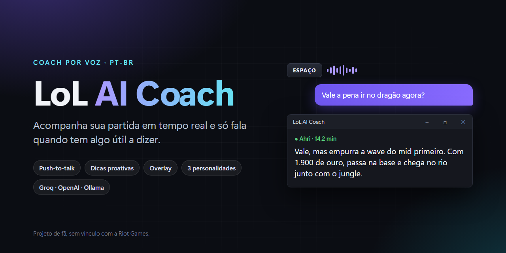
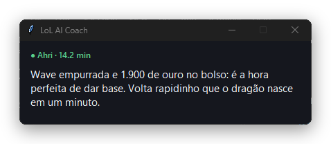
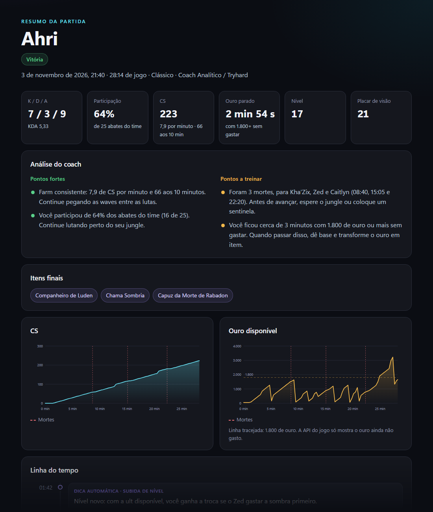
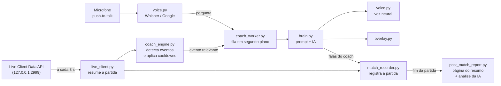

<p align="center">
  
</p>

<p align="center">
  <a href="https://github.com/guhttps/lol-ai-coach/actions/workflows/ci.yml"></a>
  <a href="https://github.com/guhttps/lol-ai-coach/releases/latest"></a>
  
  
  <a href="LICENSE"></a>
</p>

# LoL AI Coach

Coach de League of Legends **por voz**, em português do Brasil. Ele acompanha a partida em tempo real, fala só quando tem algo útil a dizer e responde às suas perguntas por push-to-talk.

> [!NOTE]
> Projeto de fã, sem vínculo com a Riot Games. *League of Legends* é marca registrada da Riot Games, Inc. O coach usa apenas a Live Client Data API local do jogo, que mostra dados da sua própria partida, e não interage com o cliente.

<p align="center">
  <br>
  <sub>O overlay fica sempre no topo, com o estado da partida e a última dica (texto de exemplo).</sub>
</p>

## Recursos

- 🎙️ **Push-to-talk:** segure `ESPAÇO`, fale e solte. A transcrição usa Whisper (Groq), com o Google Speech Recognition como reserva, e um dicionário corrige termos de LoL ("gamba" vira "gank", "flecha" vira "flash"...).
- 🧠 **Coach proativo:** detecta vida baixa, morte, renascimento, subida de nível, abates, ouro acumulado, pico de CS, itens novos dos inimigos e objetivos (dragão, barão, arauto, torres e inibidores).
- 💸 **Economia de IA:** regras locais detectam os eventos primeiro, e a IA só é chamada para transformar o evento em uma frase. Cooldowns por tipo de evento e um cooldown global evitam que o coach fale demais.
- 💬 **Conversa de verdade:** entende perguntas de acompanhamento pelo histórico recente, nunca ignora uma pergunta direta e não repete recomendações.
- ⚡ **Sem travar:** a IA responde em segundo plano enquanto o monitoramento continua, e perguntas faladas passam na frente das dicas automáticas.
- 📊 **Resumo pós-partida:** ao fim de cada partida, uma página com KDA, CS, ouro, linha do tempo, tudo o que o coach falou e uma análise com pontos fortes e pontos a treinar.
- 🗣️ **Voz neural** em pt-BR (Edge TTS), com fila própria.
- 🎭 **3 personalidades:** Debochado/Zueira, Analítico/Tryhard e Hype/Motivacional.
- 🔌 **Qualquer IA compatível com OpenAI:** Groq (padrão), OpenAI, OpenRouter ou um modelo local no Ollama.
- 👤 **Perfil editável** em `player_profile.json`: nome, lane, campeões favoritos, nível, objetivo e tom.

## Instalação

Você vai precisar de Windows 10 ou 11, microfone, internet e uma chave de API da [Groq](https://console.groq.com/keys) (gratuita) ou de outro [provedor compatível](#usar-outro-provedor-de-ia).

### Opção 1: executável (mais fácil)

1. Baixe o `LoL_AI_Coach-<versão>-windows.zip` da [última release](https://github.com/guhttps/lol-ai-coach/releases/latest) e extraia em uma pasta.
2. Faça uma cópia de `.env.example`, renomeie para `.env` e cole sua chave em `GROQ_API_KEY`.
3. Abra `LoL_AI_Coach.exe`.

Não é preciso instalar Python. Se aparecer "O Windows protegeu o computador", clique em **Mais informações** e depois em **Executar assim mesmo**: o executável não tem assinatura digital, mas é gerado pelo [GitHub Actions](.github/workflows/release.yml) direto deste código.

### Opção 2: a partir do código-fonte

Requer [Python 3.11+](https://www.python.org/downloads/) (marque **"Add Python to PATH"** na instalação).

```powershell
git clone https://github.com/guhttps/lol-ai-coach.git
cd lol-ai-coach
copy .env.example .env
notepad .env
```

Cole sua chave em `GROQ_API_KEY`, salve e dê dois cliques em **`start_coach.bat`**. Na primeira vez ele cria o ambiente virtual e instala as dependências (leva alguns minutos). Para só instalar, sem abrir o coach, use `INSTALAR_DEPENDENCIAS.bat`.

## Como usar

1. Abra o coach e escolha a personalidade.
2. Abra o LoL e entre em uma partida. O coach detecta sozinho quando ela começa e quando termina.
3. Jogue normalmente. Ele fala quando acontece algo relevante.
4. Para perguntar algo, segure `ESPAÇO`, fale e solte.
5. Quando a partida termina, o [resumo pós-partida](#resumo-pós-partida) abre no navegador.

| Ação | Como |
|---|---|
| Falar com o coach | Segure `ESPAÇO`, fale e solte |
| Fechar o overlay | Feche a janelinha; o coach continua rodando |
| Encerrar | `Ctrl+C` no terminal |

<details>
<summary><b>Exemplo de sessão no terminal</b></summary>

```text
=== LoL AI Coach v3.3.0 ===

=== Personalidade do Coach ===
1 - Debochado / Zueira
2 - Analítico / Tryhard
3 - Hype / Motivacional
Escolha [1]: 2
🎙️ Segure [SPACE] para falar.
🧠 O coach agora analisa situações automaticamente e evita falar sem motivo.
🪟 O overlay pode ser fechado sem encerrar o coach.

INFO: Live Client API indisponível; aguardando conexão com a partida.
INFO: Conexão com a Live Client API restabelecida.
🎮 Partida detectada: Ahri
💡 level_up
🗣️ Coach: Nível 6 é o seu pico. Procure a troca assim que o mid inimigo gastar a habilidade principal.
🎙️ Ouvindo... solte a tecla quando terminar.
👤 Ela: vale a pena ir no dragão agora?
🗣️ Coach: Vale, mas empurra a wave do mid primeiro. Com 1.900 de ouro, passa na base e chega no rio junto com o jungle.
🏁 Partida encerrada ou cliente indisponível.
📊 Resumo da partida salvo em C:\Jogos\lol-ai-coach\partidas\2026-11-03_21-40_Ahri.html
```

As falas do coach são geradas pela IA e mudam a cada partida.
</details>

**Dicas:**
- Jogue em modo **janela** ou **janela sem bordas**. Em tela cheia exclusiva o overlay pode não aparecer.
- A tecla `ESPAÇO` também digita no chat do jogo se ele estiver aberto. Troque a tecla com `PUSH_TO_TALK_KEY` no `.env`.

## Resumo pós-partida

Quando a partida termina, o coach salva uma página com o resumo e abre no navegador:

<p align="center">
  <br>
  <sub>Resumo de exemplo, gerado numa partida simulada com dados fictícios.</sub>
</p>

- **Números da partida:** K/D/A, participação em abates, CS por minuto e aos 10 minutos, nível, placar de visão, itens finais e quanto tempo você ficou com 1.800 de ouro ou mais sem gastar.
- **Análise do coach:** 2 pontos fortes e 2 pontos a treinar, escritos pela IA a partir dos números, no tom da personalidade escolhida.
- **Gráficos** de CS e de ouro ao longo da partida, com as mortes marcadas.
- **Linha do tempo** com abates, mortes (e quem matou), itens, níveis, objetivos e tudo o que o coach falou, inclusive as suas perguntas.

Os resumos ficam na pasta `partidas`, ao lado do `main.py` ou do executável, em um `.html` que abre em qualquer navegador e um `.json` com os mesmos dados. Partidas acompanhadas por menos de 3 minutos não geram resumo. Se você fechar o coach com `Ctrl+C` no meio da partida, ele salva um resumo parcial, sem a análise da IA. Para desligar o resumo ou só a abertura automática, use `POST_MATCH_REPORT` e `POST_MATCH_OPEN` no `.env`.

## Configuração

Todas as opções ficam no `.env`, ao lado do `main.py` ou do executável:

| Variável | Padrão | O que faz |
|---|---|---|
| `GROQ_API_KEY` | | Chave da Groq. Usada para a IA (no provedor padrão) e para transcrever a voz com Whisper. Sem ela, a transcrição usa o Google Speech Recognition. |
| `LLM_BASE_URL` | `https://api.groq.com/openai/v1` | Endereço da API de IA, compatível com OpenAI Chat Completions. |
| `LLM_API_KEY` | | Chave do provedor de IA. Na Groq, se ficar vazia, usa a `GROQ_API_KEY`. |
| `LLM_MODEL` | | Modelo de IA. Obrigatório fora da Groq. Na Groq, vazio faz o coach testar `gpt-oss-120b`, `gpt-oss-20b` e `qwen3-32b`, nessa ordem. |
| `PUSH_TO_TALK_KEY` | `space` | Tecla para falar (ex.: `f`, `x`, `caps lock`). |
| `COACH_PERSONALITY` | `1` | Personalidade sugerida ao abrir: `1`, `2` ou `3`. |
| `COACH_OVERLAY` | `true` | Mostra ou esconde o overlay. |
| `CHECK_INTERVAL_SECONDS` | `3.0` | Intervalo entre leituras da partida (mínimo `0.5`). |
| `MAX_HISTORY_MESSAGES` | `12` | Quantas mensagens recentes da conversa ficam na memória. |
| `POST_MATCH_REPORT` | `true` | Salva o [resumo pós-partida](#resumo-pós-partida) ao fim de cada partida. |
| `POST_MATCH_OPEN` | `true` | Abre o resumo no navegador assim que ele fica pronto. |

Ajustes mais finos ficam no código:

| Arquivo | O que muda |
|---|---|
| `player_profile.json` | Seu nome, lane, campeões favoritos, nível, objetivo e tom |
| `coach_engine.py` | Limites e cooldowns de cada tipo de evento |
| `brain.py` | Regras do prompt, personalidades e regras da análise pós-partida |
| `voice.py` | Voz, velocidade da fala e dicionário de termos |
| `post_match_report.py` | Visual e textos do resumo pós-partida |

### Usar outro provedor de IA

Troque `LLM_BASE_URL`, `LLM_API_KEY` e `LLM_MODEL` no `.env`. Use o nome do modelo exatamente como o provedor o identifica.

| Provedor | `LLM_BASE_URL` | `LLM_API_KEY` |
|---|---|---|
| OpenAI | `https://api.openai.com/v1` | sua chave |
| OpenRouter | `https://openrouter.ai/api/v1` | sua chave |
| Ollama (local) | `http://localhost:11434/v1` | não precisa |

A transcrição da voz continua na Groq se houver `GROQ_API_KEY`. Com o Ollama e sem chave da Groq, o coach funciona sem nenhuma conta: a IA roda no seu PC e a transcrição usa o Google Speech Recognition.

## Como funciona



O coach lê o estado da partida, compara com a leitura anterior e só chama a IA quando um evento passa pelos filtros locais. Assim ele gasta poucas requisições e não interrompe você à toa. Se a IA decidir que não há nada útil a dizer em uma dica automática, ela responde `SILENCIO` e o coach fica quieto.

| Arquivo | Responsabilidade |
|---|---|
| `main.py` | Loop principal: push-to-talk, monitoramento e sessões |
| `live_client.py` | Leitura e normalização da Live Client Data API |
| `item_data.py` | Identificação de itens finalizados pelo Data Dragon |
| `coach_engine.py` | Detecção local de eventos e cooldowns |
| `coach_worker.py` | Fila das chamadas de IA em segundo plano |
| `brain.py` | Prompts, personalidades e chamadas à API de IA |
| `voice.py` | Transcrição (STT) e síntese de voz (TTS) |
| `overlay.py` | Janela sempre no topo (Tkinter) |
| `match_recorder.py` | Registro da partida para o resumo: amostras, eventos e falas |
| `post_match_report.py` | Página do resumo pós-partida e análise final |
| `config.py` | Versão, configurações do `.env` e perfil |

## Solução de problemas

<details>
<summary><b>O push-to-talk não responde</b></summary>

A biblioteca `keyboard` pode exigir permissão de administrador no Windows. Clique com o botão direito no `start_coach.bat` (ou no `LoL_AI_Coach.exe`) e escolha **Executar como administrador**. Confira também se `PUSH_TO_TALK_KEY` no `.env` tem um nome de tecla válido.
</details>

<details>
<summary><b>"Configure LLM_API_KEY ou GROQ_API_KEY no arquivo .env"</b></summary>

O coach não encontrou sua chave. Confirme que o arquivo se chama exatamente `.env` (e não `.env.txt`) e que está na mesma pasta do `main.py` ou do executável. Para ver a extensão real no Explorador de Arquivos, ative **Exibir > Mostrar > Extensões de nomes de arquivos**.
</details>

<details>
<summary><b>"Live Client API indisponível; aguardando conexão com a partida"</b></summary>

É normal fora de uma partida: a API do jogo só responde durante a partida. No lobby e na seleção de campeões o coach fica esperando e se conecta sozinho quando o jogo começa.
</details>

<details>
<summary><b>O coach fica muito tempo em silêncio</b></summary>

É de propósito. Ele só fala quando um evento relevante acontece, respeita um intervalo mínimo entre falas automáticas e fica quieto quando não tem nada útil a acrescentar. Perguntas feitas por voz são sempre respondidas.
</details>

<details>
<summary><b>"O limite da API configurada foi atingido"</b></summary>

O plano gratuito da Groq tem limite de requisições por minuto e por dia. Espere alguns minutos, defina outro modelo em `LLM_MODEL` ou use outro provedor.
</details>

<details>
<summary><b>O overlay não aparece</b></summary>

Jogue em modo janela ou janela sem bordas e confira se `COACH_OVERLAY=true` no `.env`. Se você fechou o overlay, ele só volta quando o coach for aberto de novo.
</details>

<details>
<summary><b>O resumo da partida não apareceu</b></summary>

O resumo é salvo 12 segundos depois que o jogo fecha, o tempo que o coach espera antes de considerar a partida encerrada. Partidas acompanhadas por menos de 3 minutos (um remake, por exemplo) não geram resumo. Confira também `POST_MATCH_REPORT` e `POST_MATCH_OPEN` no `.env`: com a abertura automática desligada, o arquivo continua na pasta `partidas`.
</details>

## Limitações

A Live Client Data API não fornece posição no mapa, cooldowns dos inimigos, visão real nem a intenção dos jogadores. O coach é instruído a **não inventar** o que não está nos dados.

## Privacidade e segurança

- O `.env` com a sua chave está no `.gitignore` e **não deve ser publicado**.
- Enquanto você segura a tecla, o áudio do microfone é enviado à Groq (ou ao Google, na reserva) para transcrição.
- O estado da partida e as perguntas vão para o provedor definido em `LLM_BASE_URL`. A voz do coach é gerada pelo Edge TTS, da Microsoft.
- Os resumos pós-partida ficam só no seu PC, na pasta `partidas` (que está no `.gitignore`). Para a análise final, o provedor de IA recebe um resumo numérico da partida e a linha do tempo, sem as suas perguntas.
- Não existe servidor próprio: nada é guardado fora da sua máquina além do que os provedores acima recebem.

## Desenvolvimento

```powershell
python -m pip install -r requirements-dev.txt
python -m unittest discover -s tests -v   # testes (não precisam do LoL aberto)
ruff check .                              # lint
.\scripts\build.ps1                       # gera o executável e o .zip
```

Os testes simulam a Live Client API, a Groq e o Data Dragon, e rodam no CI a cada push com Python 3.11 a 3.14. Veja o [guia de contribuição](CONTRIBUTING.md) e o [histórico de mudanças](CHANGELOG.md).

## Próximos passos

- [ ] Integração opcional com a Riot API (histórico e matchups)
- [ ] Detecção de lane/role
- [ ] Histórico das partidas, comparando os resumos ao longo do tempo
- [ ] Configuração gráfica de personalidade, frequência e volume
- [ ] Comandos de voz como "fica quieta" e "fala mais"

Tem outra ideia? [Abra uma sugestão](https://github.com/guhttps/lol-ai-coach/issues/new?template=feature_request.yml).

## Licença

[MIT](LICENSE)
